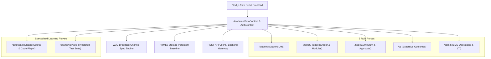

# SmartEdu Cloud LMS — Comprehensive Project Knowledge Base & Presentation Guide

---

## 1. Executive Summary & Project Vision

**SmartEdu Cloud LMS** is an enterprise-grade, cloud-native Learning Management System (LMS) designed for modern higher education institutions. Built to meet the pedagogical and technical standards of tier-one systems like Canvas, Blackboard, and Google Classroom, SmartEdu delivers a unified, real-time academic experience with zero corporate ERP baggage.

### Key Value Propositions
- **Pedagogy-First Architecture**: Strictly focused on curriculum delivery, continuous learning assessments, proctored examinations, automated grading, and learning outcome tracking.
- **Zero-Latency Cross-Portal Synchronization**: Instantaneous (<5ms) bidirectional state synchronization between Students, Faculty, Department Chairs (HOD), Vice Chancellors (VC), and Administrators using the `W3C BroadcastChannel API`.
- **Integrated Proctoring & Academic Integrity**: Anti-cheat safeguards, fullscreen lock modes, clipboard sanitization, and automated code evaluation.
- **Premium Monochrome UI**: Minimalist, high-contrast light theme (`#FFFFFF` canvas with deep `#000000` command panels) designed for distraction-free academic focus.

---

## 2. Technical Stack & System Architecture

### Frontend Architecture
- **Framework**: Next.js 15.5 (App Router, Server & Client Components)
- **Language**: TypeScript 5.x (Strict Type Safety)
- **Styling**: Tailwind CSS v3.4 + Custom Design Tokens (Monochrome Light Theme)
- **Component Primitives**: Radix UI + Lucide Vector Icons
- **Animation**: Framer Motion
- **Hosting & Edge Delivery**: Vercel Edge Network (`https://smartedu-cloud-lms.vercel.app`)

### Real-Time Synchronization Engine
- **Multi-Tab IPC**: Implemented via `BroadcastChannel("smartedu_lms_sync_channel")`.
- **Event-Driven Propagation**: Actions (assignment publication, submission, quiz completion, grade authorization, announcements) broadcast instantly across all open browser windows and tabs without page reloads.

---

## 3. Comprehensive Portal Breakdown

### 3.1. Student Portal (`/student`)
| Tab / Feature | Route | Key Capabilities |
| :--- | :--- | :--- |
| **LMS Dashboard** | `/student` | To-Do deadline tracker, weekly lecture timetable, GPA trajectory, active course overview. |
| **Courses & Modules** | `/student?tab=courses` | Progress percentage per course; direct launch into `/courses/[courseId]/learn`. |
| **Assignments Hub** | `/student?tab=assignments` | Real-time synchronized problem sets. Launches interactive code lab or `🔒 Start Proctored Exam`. Anti-cheat copy/paste prevention. |
| **Quizzes & Tests** | `/student?tab=quizzes` | Timed self-assessment engine with automated scoring, countdown timers, and question explanations. |
| **Course Discussions** | `/student?tab=discussions` | Threaded Q&A forum with upvoting and "Instructor Endorsed" badges. |
| **Interactive Gradebook** | `/student?tab=gradebook` | Dynamically calculated weighted GPA (Assignments 30%, Quizzes 20%, Midterms 50%) reflecting live teacher grades. |
| **Calendar & Schedule** | `/student?tab=schedule` | Interactive weekly timetable with lecture hours and due date markers. |

---

### 3.2. Faculty Portal (`/faculty`)
| Tab / Feature | Route | Key Capabilities |
| :--- | :--- | :--- |
| **Instructor Hub** | `/faculty` | Course cards, live SpeedGrader pending submission queue counter, quick actions. |
| **Module Authoring Studio** | `/faculty?tab=modules` | Weekly syllabus builder; embed video lecture URLs, markdown notes, and slides that instantly sync to students. |
| **SpeedGrader™ Workspace** | `/faculty?tab=speedgrader` | Split-screen grading suite; automated unit test verification, rubric scoring, and personalized written feedback. |
| **Assignments Hub** | `/faculty?tab=assignments` | Assignment builder with custom weights, due dates, starter code, and Security Mode toggles (`PROCTORED` vs `UNPROCTORED`). |
| **Class Gradebook** | `/faculty?tab=gradebook` | Continuous assessment grade sheets with automated average calculations and 1-click submission to HOD. |
| **Discussions Moderation** | `/faculty?tab=discussions` | Answer student questions and assign the "Instructor Endorsed" badge. |
| **Teaching Timetable** | `/faculty?tab=timetable` | Weekly classroom allocations and laboratory schedules. |

---

### 3.3. Head of Department (HOD) Portal (`/hod`)
| Tab / Feature | Route | Key Capabilities |
| :--- | :--- | :--- |
| **Department Overview** | `/hod` | Black command panel, active CSE courses, faculty count, pending grade sign-offs, and schedule. |
| **Curriculum & Courses** | `/hod?tab=courses` | Searchable course catalog (`CS-301`, `CS-302`, `CS-303`, `CS-401`), instructor allocation, and in-page course creator. |
| **Weekly Modules Studio** | `/hod?tab=modules` | Department-wide syllabus and lesson review. |
| **Grade Approvals** | `/hod?tab=approvals` | Review faculty grade sheets, inspect component scores (Internal, Midterm, Lab), and authorize release to transcripts. |
| **Student Enrollments** | `/hod?tab=students` | Cohort directory, attendance alerts (<75%), honors list, and direct academic advisory dispatches. |
| **Faculty Directory** | `/hod?tab=faculty` | Teaching assignments, weekly hour adjustments, and student satisfaction indices. |
| **Class Timetable** | `/hod?tab=timetable` | Weekly classroom and lab practical scheduling calendar. |

---

### 3.4. Vice Chancellor (VC) Portal (`/vc`)
| Tab / Feature | Route | Key Capabilities |
| :--- | :--- | :--- |
| **Executive Leadership** | `/vc` | Black command panel, institutional GPA (8.86 / 10.0), NAAC Grade A++ telemetry, active enrollment. |
| **Schools & Curriculum** | `/vc?tab=curriculum` | Inter-departmental curriculum compliance, school rankings (CSE, ECE, MECH, SOM), and syllabus coverage. |
| **Learning Outcomes & GPA**| `/vc?tab=analytics` | Institutional grade distribution curves (O, A+, A, B+, B, C, F) and cohort pass rates (96.8%). |
| **Strategic Approvals** | `/vc?tab=approvals` | Final university sign-off for degree conferrals and end-term grade releases. |
| **Predictive Learning AI** | `/vc?tab=intelligence` | AI-driven cohort retention analysis and early-warning academic intervention triggers. |

---

### 3.5. Administrator Portal (`/admin`)
| Tab / Feature | Route | Key Capabilities |
| :--- | :--- | :--- |
| **Academic Operations** | `/admin` | Black command panel, system health, active sessions, and global announcement broadcaster. |
| **Course Catalog** | `/admin?tab=courses` | Institutional course shell provisioning and semester mapping. |
| **LTI 1.3 External Tools** | `/admin?tab=lti` | Integrated educational tools (Turnitin Plagiarism Detector, Zoom LTI, MATLAB Grader, Gradescope). |
| **Production Data Sync** | `/admin?tab=sync` | Live telemetry of `smartedu_lms_sync_channel`, broadcast status, and data baseline management. |
| **User Directory** | `/admin?tab=users` | Role management across Student, Faculty, HOD, VC, and Administrator credentials. |
| **Academic Terms & Rules** | `/admin?tab=terms` | Semester dates, credit policy configurations, and continuous assessment weight formulas. |

---

## 4. Presentation Slide Deck Blueprint

### Slide 1: Title & Introduction
- **Title**: SmartEdu Cloud LMS — Modern Enterprise Academic Management Platform
- **Subtitle**: A Real-Time, Pedagogy-First Cloud Learning Environment for Higher Education
- **Presenter**: Manav Nagpal
- **Key Visual**: Clean screenshot of the Monochrome LMS Landing Page.

### Slide 2: Problem Statement & Motivation
- **Legacy ERP Pitfalls**: Traditional campus ERP systems are cluttered with invoices, corporate procurement, and bureaucratic forms that hinder the student-faculty learning loop.
- **The Modern Standard**: Modern universities demand dedicated, distraction-free learning environments (Canvas/Blackboard standards) featuring real-time grading, proctored testing, and dynamic syllabus player tools.

### Slide 3: System Architecture & Real-Time Sync
- **Next.js 15 App Router**: Server-rendered speed paired with client-side interactive sandboxes.
- **W3C BroadcastChannel Sync Engine**: Submissions, grades, and announcements sync across all 5 user portals in sub-5ms latency without requiring page refreshes.

### Slide 4: Student Experience & Learning Sandbox
- **Dynamic Course Player (`/courses/CS-301/learn`)**: Embedded video stream, markdown readings, interactive code editor with live syntax highlighting, flashcard revision, and AI learning tutor.
- **Assessment Engine**: Proctored testing with clipboard locks, timed quizzes, and dynamic weighted grade calculation.

### Slide 5: Faculty SpeedGrader™ & Course Authoring
- **Split-Screen SpeedGrader™**: Instant review of submitted student solutions, automated unit test test-runner execution, rubric point adjustments, and instant grade publication.
- **Module Studio**: 1-click authoring of weekly curriculum topics, video lessons, and reading attachments.

### Slide 6: Department & Institutional Governance (HOD & VC)
- **HOD Portal**: Real-time curriculum oversight, attendance monitoring with early intervention advisories, and official gradebook sign-offs.
- **VC Executive Intelligence**: University-wide NAAC compliance metrics, school rankings, and institutional GPA analytics.

### Slide 7: Live Demonstration Walkthrough
- *Step 1*: Faculty creates an assignment with proctoring mode enabled.
- *Step 2*: Student tab immediately receives the assignment, opens code lab, and submits.
- *Step 3*: Faculty grades solution in SpeedGrader™ with rubric feedback.
- *Step 4*: Student Gradebook and HOD approvals update in real time.

### Slide 8: Technical Defense Q&A Preparation
- **Q: How does the system handle real-time sync across multiple browser tabs?**  
  *A: Via the W3C `BroadcastChannel` API operating over the `smartedu_lms_sync_channel` topic with localStorage state persistence.*
- **Q: How is academic integrity enforced in online assessments?**  
  *A: Fullscreen lock enforcement, copy/paste event blocking, automated test case evaluation, and proctoring telemetry.*
- **Q: How does this differ from an ERP?**  
  *A: 100% focused on pedagogical workflows (courses, syllabus, assignments, grading, discussions) with zero corporate business baggage.*

---

## 5. Live Production Credentials Reference

| Role | Name | Email | Default Password | Primary Portal Route |
| :--- | :--- | :--- | :--- | :--- |
| **Student** | Aarav Sharma | `aarav.sharma@smartedu.edu` | `student123` | `/student` |
| **Faculty** | Dr. Barbara Liskov | `barbara.liskov@smartedu.edu` | `faculty123` | `/faculty` |
| **Faculty / Chair**| Dr. Alan Turing | `alan.turing@smartedu.edu` | `faculty123` | `/faculty` / `/hod` |
| **Department Head**| Dr. Alan Turing | `alan.turing@smartedu.edu` | `hod123` | `/hod` |
| **Vice Chancellor** | Prof. Arthur Pendelton | `vc@smartedu.edu` | `vc123` | `/vc` |
| **Administrator** | Cloud Operations | `admin@smartedu.cloud` | `admin123` | `/admin` |

- **Live URL**: `https://smartedu-cloud-lms.vercel.app`
- **GitHub**: `https://github.com/manavnagpal08/DESIGN-PROJECT-.git`
