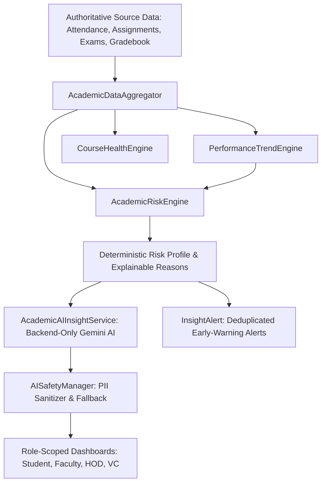

# SmartEdu Cloud — Academic Intelligence Architecture

## 1. Domain Overview
SmartEdu Cloud Phase 10 introduces an authoritative, derived **Academic Intelligence & Early-Warning Layer** that transforms raw attendance logs, assignments, quiz and exam scores, and semester gradebooks into:
- Actionable early-warning risk scores and severity classifications (`LOW`, `MEDIUM`, `HIGH`, `CRITICAL`).
- Transparent, explainable factor breakdowns.
- Student academic performance profiles and trajectory trends (`IMPROVING`, `STABLE`, `DECLINING`).
- Course health metrics and difficult topic identification.
- Departmental and institutional health analytics.
- Privacy-preserving, backend-only Gemini AI insights with deterministic offline fallbacks.

---

## 2. Core Data Flow

---

## 3. Database Schema

| Table Name | Primary Key | Key Foreign Keys & Indexes | Purpose |
| :--- | :--- | :--- | :--- |
| **`academic_risk_snapshots`** | `id` (UUID) | `student_id` $\to$ `users.id`, `semester_id` $\to$ `semesters.id`, `Index(student_id, snapshot_date)`, `Index(risk_level)` | Daily/on-demand derived performance profile and risk score snapshot |
| **`risk_configurations`** | `id` (UUID) | Unique `name`, active flag | Configurable component weights (attendance 25%, assignments 20%, exams 30%, trend 25%) and alert thresholds |
| **`insight_alerts`** | `id` (UUID) | `user_id` $\to$ `users.id`, Unique `dedup_key`, `Index(user_id, is_read)` | Deduplicated early-warning alerts for students and advisors |
