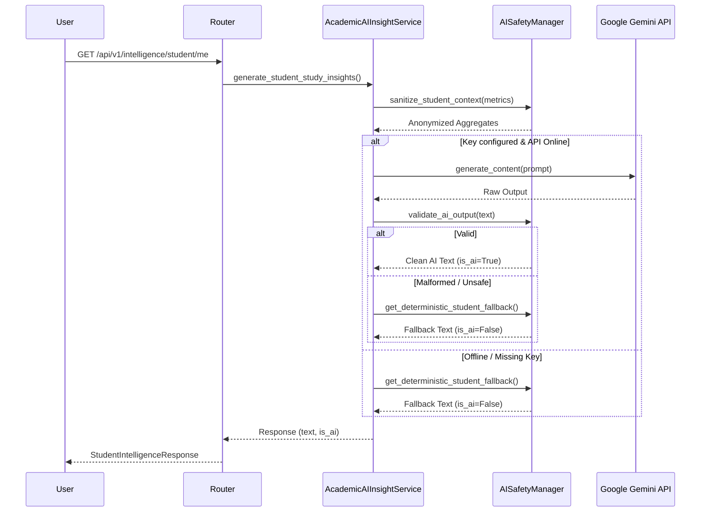

# SmartEdu Cloud — AI Insights & Gemini Integration

## 1. Architectural Principles
Gemini AI is integrated strictly as a **non-authoritative advising assistant** for generating natural language study tips and cohort summaries:
- **Zero Primary Authority**: Gemini cannot change grades, marks, attendance, or transcripts.
- **Strict Backend Isolation**: Calls are made exclusively on the server (`app/intelligence/ai/insight_service.py`).
- **PII Minimization**: The prompt context sends only numerical aggregates (`GPA`, `attendance %`, `assignment %`). Names, emails, student IDs, and contact info are stripped before sending.
- **Deterministic Offline Fallback**: If `GEMINI_API_KEY` is absent, invalid, or experiences network disruption, the system falls back to `AISafetyManager.get_deterministic_student_fallback()` with zero UI degradation.

---

## 2. Validation & Hallucination Prevention

