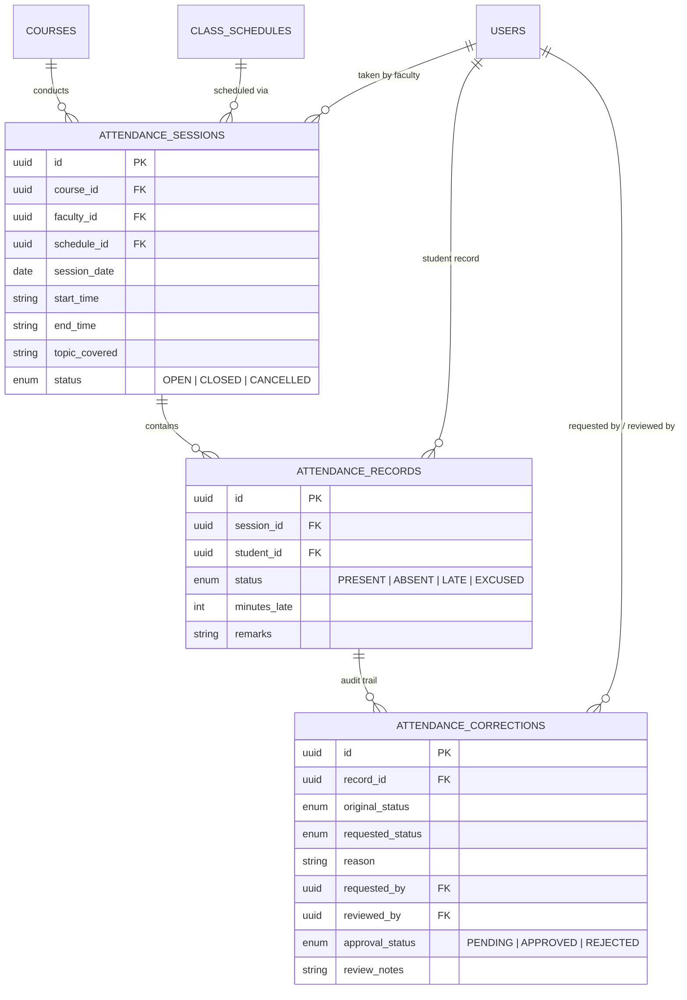

# SmartEdu Cloud — Phase 08: Attendance Management & Audit Engine

## 1. Overview & Architecture

The **Attendance Management & Academic Audit Engine** provides institutional tracking of student attendance across lectures, laboratories, and tutorials. It enforces strict data integrity rules, role-scoped access control, historical immutability via closed session locking, and formal correction workflows reviewed by departmental authorities (HOD / Administrator).

---

## 2. Security & Scope Enforcement

SmartEdu Cloud enforces 5-tier role-based access control (RBAC):

| Role | Attendance Permissions |
| :--- | :--- |
| **STUDENT** | Read-only access to own attendance records and course summaries via `/students/me/attendance`. IDOR blocked (cannot access other students' records). |
| **FACULTY** | Can create attendance sessions, mark/edit records, and close sessions for assigned courses only. Unassigned courses return `403 Forbidden`. |
| **HOD** | Can view department-wide attendance analytics, export CSV audit logs, and review/approve/reject attendance correction requests. |
| **VC** | Institution-wide attendance KPIs and cross-department analytics. |
| **ADMINISTRATOR** | System-wide attendance administration, timetable scheduling, and emergency corrections. |

---

## 3. Data Model & Entity Relations

---

## 4. Attendance Percentage Formula & Status Thresholds

### 4.1 Calculation Formula
$$\text{Attendance \%} = \frac{\text{PRESENT} + \text{LATE}}{\text{Total Sessions} - \text{EXCUSED}} \times 100$$

*Note: `EXCUSED` sessions are deducted from the denominator so authorized medical or institutional absences do not penalize the learner.*

### 4.2 Status Thresholds
- **$\ge 75\%$**: `GOOD` — Meets institutional exam eligibility requirements.
- **$65\% \le \text{Rate} < 75\%$**: `WARNING` — Automated notification to student and faculty mentor.
- **$< 65\%$**: `CRITICAL` — High risk of examination debarment; flagged for academic audit.

---

## 5. Closed Session Immutability & Correction Workflow

1. When a faculty user creates a session, its initial status is `OPEN`.
2. Faculty can freely edit attendance records during the active session window.
3. Upon completion, faculty triggers `POST /attendance/sessions/{id}/close` setting status to `CLOSED`.
4. **Immutability Protection**: Any subsequent direct write to `CLOSED` sessions is rejected with `400 Bad Request`.
5. **Formal Correction Workflow**:
   - Faculty submits `POST /attendance/corrections` specifying `record_id`, `requested_status`, and `reason`.
   - The correction appears in the HOD's approval queue (`GET /hod/attendance/pending-corrections`).
   - HOD reviews and submits `PATCH /attendance/corrections/{id}` with `approval_status: APPROVED | REJECTED`.
   - If approved, the service layer automatically updates `AttendanceRecord.status` to the approved value and records the audit log.
