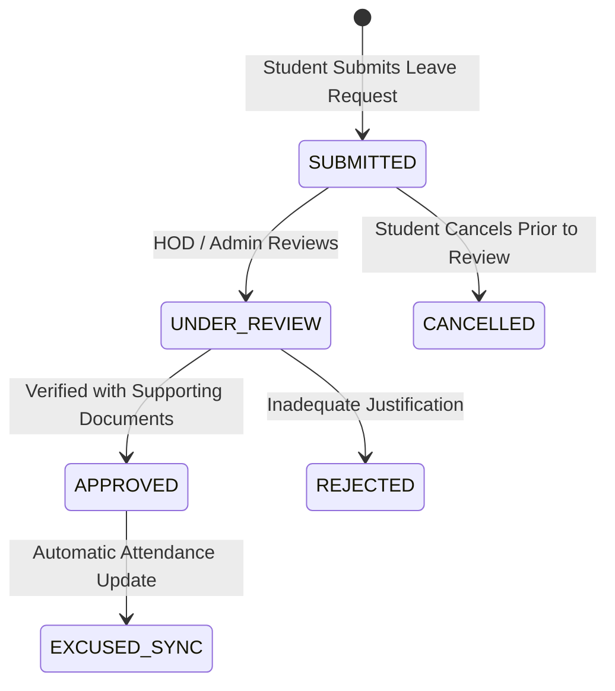

# SmartEdu Cloud — Leave Management & Automated Attendance Synchronization

## 1. Overview
The Leave Management Engine provides a formal, auditable workflow for student leave applications and automatically synchronizes approved leaves with attendance session records.

## 2. Leave Lifecycle & Workflow

## 3. Date Overlap Prevention & Invariant
- A student cannot have multiple overlapping active leave requests (`SUBMITTED`, `UNDER_REVIEW`, `APPROVED`).
- Attempts to submit overlapping dates trigger an HTTP 400 Bad Request exception.

## 4. Authoritative Attendance Synchronization
When a leave request is marked `APPROVED`:
1. The system queries all `attendance_records` for the student where the session date falls within `[start_date, end_date]`.
2. Any record with status `ABSENT` is automatically updated to `EXCUSED`.
3. The record's remarks are annotated with `"Excused via approved leave [ID: ...] - [Reviewer Notes]"`.
4. Session-level metrics (`absent_count`, `excused_count`) are atomically updated.
5. A high-priority notification is dispatched to the student confirming approval and excused attendance.
