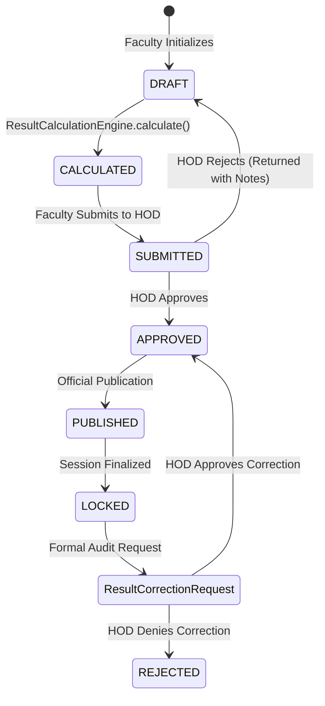

# SmartEdu Cloud — Academic Results & Performance Architecture

## 1. Domain Overview
SmartEdu Cloud Phase 09 delivers an authoritative, centralized Academic Result & Transcript Engine that unifies coursework assignments, quizzes, midterms, final examinations, and attendance into a credit-weighted GPA/CGPA performance system.

---

## 2. Result Lifecycle State Machine

### Lifecycle States
- **`DRAFT`**: Initial uncalculated state.
- **`CALCULATED`**: Components aggregated, normalized, and mapped to letter grade and grade points.
- **`SUBMITTED`**: Faculty locks provisional results and forwards to HOD for departmental oversight.
- **`APPROVED`**: Head of Department verifies grading integrity and signs off.
- **`PUBLISHED`**: Results become visible to enrolled students on their portals and transcripts.
- **`LOCKED`**: Historical result is immutable; can only be modified via formal `ResultCorrectionRequest` approved by HOD/Admin.

---

## 3. Database Entities & Constraints

| Entity | Primary Key | Key Foreign Keys & Constraints |
| :--- | :--- | :--- |
| **`GradeScale`** | `id` (UUID) | Unique `name`, `is_default` flag. |
| **`GradeScaleItem`** | `id` (UUID) | `grade_scale_id` $\rightarrow$ `grade_scales.id`, `UniqueConstraint(grade_scale_id, grade)`. |
| **`CourseAssessmentWeight`** | `id` (UUID) | `course_id`, `semester_id`, `UniqueConstraint(course_id, semester_id, component_type)`. Total weights per course must sum to $100\%$. |
| **`CourseResult`** | `id` (UUID) | `student_id`, `course_id`, `semester_id`, `UniqueConstraint(student_id, course_id, semester_id)`. |
| **`ResultComponentScore`** | `id` (UUID) | `result_id` $\rightarrow$ `course_results.id`, `component_type`, raw score, max score, percentage, weighted contribution. |
| **`ResultCorrectionRequest`** | `id` (UUID) | `result_id`, `student_id`, `course_id`, `requested_by`, `reviewed_by`, audit timestamps and reason notes. |
| **`SemesterResult`** | `id` (UUID) | `student_id`, `semester_id`, `UniqueConstraint(student_id, semester_id)`, registered credits, earned credits, semester GPA. |
